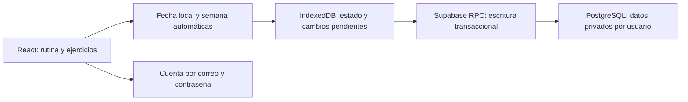

# Backend de GLOW con registro automático

Actualizado el 12 de octubre de 2026 según la revisión del propietario. Implementación validada localmente; el proyecto y su configuración pública ya están disponibles. El ingreso utiliza la cuenta con correo y contraseña que administra Supabase Auth. Para instalarlo, seguir [supabase-setup.md](supabase-setup.md).

## Experiencia de uso acordada

El usuario ingresa con correo y contraseña, elige una rutina y entrena. La app calcula fecha y semana y guarda el avance sin pedir que seleccione una semana ni active un plan. Una sesión persistida vuelve directamente a entrenamientos; al cerrar sesión se muestra nuevamente el login.

La app abre **Resumen**, con el selector de rutinas, información del programa, estadísticas acumuladas y avance semanal. El saludo usa el nombre opcional de `profiles.display_name`, administrado en Supabase, sin agregar campos al login. Los días A/B/C/D siguen disponibles para elegir un entrenamiento. Si cambia la fecha mientras se está en una pestaña de ejercicios, se sugiere el entrenamiento del calendario o el siguiente si hoy es descanso. Independientemente de esa elección, la sesión pertenece a la fecha real de uso, no a la fecha sugerida por la plantilla.

Las marcas previas del navegador y del prototipo no se importan. El historial nuevo empieza con esta implementación. No se exige borrar el almacenamiento anterior: simplemente se utiliza un espacio nuevo para la caché y no se leen las marcas viejas.

## Arquitectura

React y Vite siguen desplegándose como archivos estáticos en Netlify. Supabase Auth identifica al usuario y su Data API/RPC permite acceder a PostgreSQL. RLS y las comprobaciones explícitas de propiedad en las funciones protegen cada cuenta. No se agrega un servidor Express ni un cron de reinicio.

Las rutinas públicas permanecen en `public/routines/`. Tienen IDs permanentes para secciones y ejercicios, weekdays numéricos y una versión. Cada semana guarda un snapshot para conservar la prescripción histórica si luego se cambia el JSON.

## Datos

| Tabla | Responsabilidad |
| --- | --- |
| `profiles` | Identidad vinculada a `auth.users`, zona horaria IANA y rutina elegida |
| `workout_weeks` | Agrupación interna por usuario, rutina y lunes local; snapshot de la rutina |
| `workout_sessions` | Día de plantilla más `session_date`, fecha real del entrenamiento; estado, revisión y timestamps |
| `workout_exercises` | Prescripción histórica y estado de cada ejercicio de la sesión |
| `workout_sets` | Estado individual de cada serie |
| `progress_operations` | Recibos de cambios confirmados para evitar efectos duplicados |

La clave única de sesión es `(week_id, day_id, session_date)`. Reabrir hoy reutiliza la sesión. Entrenar el mismo Día A mañana crea otra. La relación por usuario también se comprueba en las claves foráneas compuestas.

`planned_date` conserva la sugerencia del programa; `session_date` identifica la fecha real del entrenamiento. Una sesión completada usa esa fecha como `performed_date`, incluso si la cola se envía después de medianoche. Los timestamps del servidor pueden reflejar el momento de sincronización cuando hubo un corte; no se presentan como una medición de duración real.

La preparación automática genera contextos vacíos para los días de plantilla disponibles. Una fila con estado `scheduled` y revisión cero no equivale a un entrenamiento realizado. Los resúmenes futuros deberán contar actividad con marcas o inicio, y calcular lo previsto desde el calendario del snapshot, no sumar todos los contextos vacíos como entrenamientos pendientes.

## Calendario automático

- Fecha local según la zona del perfil; semana de lunes a domingo.
- Actualización al volver a la app y cada minuto, incluyendo el paso de medianoche.
- Preparación idempotente de los contextos de hoy al cargar una rutina, sin controles manuales.
- Carga de las marcas de la fecha actual únicamente en las tarjetas de ejercicios.
- Conservación de sesiones anteriores en PostgreSQL y en la caché local nueva.
- En **Resumen** se muestra el avance de los entrenamientos de la rutina actual durante la semana y estadísticas del historial completo disponible. El selector de rutinas está únicamente en esta pantalla. No hay navegación de semanas históricas en esta entrega.
- Reiniciar una sesión modifica solo ese entrenamiento de hoy; no borra otras fechas.

## Guardado y reconexión

Cada marca actualiza su estado y agrega una operación a la cola en una misma transacción de IndexedDB. En la nube se envía un estado absoluto, un UUID de operación y la revisión esperada. La función bloquea la sesión, valida al dueño, aplica el cambio y devuelve el estado confirmado. Repetir la operación no invierte ni duplica su efecto.

Series, ejercicio y estado de sesión se actualizan juntos. La app conserva por separado el estado remoto confirmado y el borrador pendiente: una lectura lenta no puede reemplazar un guardado más reciente.

La cola se procesa por cuenta, con reintentos de fallos temporales. Al cerrar sesión nunca se envían los cambios de esa cuenta bajo otra identidad. La UI indica guardando, guardado, pendiente o error en una línea discreta.

Si otra copia de la app modificó la misma sesión, se solicita elegir entre conservar la nube o aplicar los cambios propios. La decisión afecta solo al entrenamiento en conflicto; los demás conservan su cola.

La tolerancia a cortes requiere que el contexto actual se haya cargado. Abrir desde cero sin Internet o preparar por primera vez un nuevo día remoto sin conexión no está cubierto por esta entrega: la caché de assets y un bootstrap offline del servidor requieren trabajo adicional.

## Seguridad y configuración

El cliente recibe URL pública y clave publishable, más el token de su sesión. No se incluyen secretos ni contraseña de PostgreSQL en el frontend. Las tablas tienen lectura con RLS por usuario y no permiten edición directa desde el navegador.

Los RPC autorizados obtienen la identidad desde `auth.uid()`. Sus funciones privilegiadas usan `search_path` cerrado, relaciones calificadas y comprobaciones explícitas del dueño. Los helpers privados no tienen ejecución para usuarios de la API.

El SQL inicial está en `supabase/migrations/202610120001_workout_backend.sql`. Incluye la estructura y las funciones en una transacción y está preparado para un proyecto nuevo. Esta versión se actualizó antes de su instalación; no es una migración para una base que ya hubiera aplicado el prototipo anterior.

El login llama a `signInWithPassword` con una cuenta existente de Supabase Auth. No requiere un código ni crea cuentas. Vite necesita `VITE_SUPABASE_URL` y `VITE_SUPABASE_PUBLISHABLE_KEY` antes de compilar `dist`; el frontend nunca almacena la contraseña.

## Próxima entrega

El Resumen ya incluye días y semanas con actividad, sesiones completas, ejercicios, series y minutos estimados de sesiones completas. Una próxima entrega puede agregar un historial detallado por fecha y navegación de semanas anteriores. Las cargas, repeticiones realizadas, notas y duración real requieren campos y controles específicos; las prescripciones de los JSON no deben confundirse con resultados reales.

Ver [qa-report.md](../qa-report.md) para las pruebas y sus limitaciones. Se verificó SQL real en PostgreSQL embebido y flujos de navegador con una API simulada. Una consulta de solo lectura confirmó que el proyecto alojado responde y permite autenticación por correo; el acceso con una contraseña real y las políticas desplegadas se comprueban desde la app con la cuenta del propietario.

## Referencias

- [Supabase: RLS](https://supabase.com/docs/guides/database/postgres/row-level-security).
- [Supabase: API keys](https://supabase.com/docs/guides/getting-started/api-keys).
- [Supabase: funciones de PostgreSQL](https://supabase.com/docs/guides/database/functions).
- [Supabase: autenticación con contraseña](https://supabase.com/docs/guides/auth/passwords).
- [Hevy: seguimiento e historial](https://www.hevyapp.com/features/gym-progress/), como referencia para separar plantillas de rutinas y sesiones realizadas.
